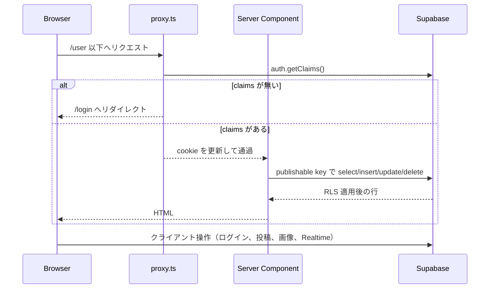

# my-blog 調査メモ

調査日: 2026-10-18  
対象: リポジトリ作業ツリー（`main`、`origin/main` と一致するコミット `9e05ec2` に、調査開始前からあった未コミット差分が1件ある）

この文書はコードと設定の読み取り、およびローカルで実行した型チェック・Lint・本番ビルドの結果に基づく。ブラウザでの操作確認、開発サーバー起動、Supabase への接続、デプロイ環境の確認は行っていない。動作確認していない事項は「未検証」と書く。

調査開始時点の未コミット差分は `app/components/elements/ManagePostsSearch.tsx` の空行2行のみ。本調査ではそのファイルを変更していない。

---

## 1. プロジェクトの概要

個人がアカウントを作り、Markdown の記事を投稿・公開し、ログインなしで公開記事を読めるブログ。README の説明と、実装されている画面の対応はおおむね一致する。メールアドレス変更は実装されているが README の機能一覧には無い。パスワード再設定画面は UI のみで送信処理が無い。

確認できた構成:

- フロントエンドは Next.js App Router（インストール済み `next@16.4.2`）+ React 19 + TypeScript。
- スタイルは Tailwind CSS 4。記事本文の体裁は CSS Modules。
- バックエンド相当の処理は、アプリ内の独自 API ではなく、ブラウザと Server Component の両方から Supabase クライアントを直接呼ぶ。
- 永続化先としてコードが参照しているのは Supabase の `posts` テーブル、`profiles` テーブル、Storage バケット `myblog-user-assets`、Supabase Auth。
- ホスティングは README と `next.config.ts` から Vercel を想定している。リポジトリ内に `vercel.json` は無い。デプロイ設定の中身は未確認。

README のインフラ図は「Server Actions / API Routes」と「Admin Access / Secret Key」を書いている。コード上は Server Action（`'use server'`）も `app/api` の Route Handler も無く、サービスロールキーも参照していない。サーバー側もブラウザ側も `NEXT_PUBLIC_SUPABASE_PUBLISHABLE_KEY` を使う。RLS をバイパスする実装はリポジトリ内に無い。

---

## 2. ディレクトリ構成と主要ファイルの役割

```
my-blog/
├── app/                          # App Router の画面、共通 UI、認証コンテキスト
│   ├── (auth)/                   # ログイン、サインアップ、パスワード再設定
│   ├── (main)/                   # ヘッダー付きの閲覧・投稿・設定画面
│   ├── components/elements/      # 検索、プレビュー、モーダル、アバター
│   ├── components/layouts/Header/
│   ├── context/AuthContext.tsx
│   ├── hooks/useAuth.tsx
│   ├── types/index.ts
│   ├── layout.tsx / error.tsx / loading.tsx / not-found.tsx / globals.css
├── features/
│   ├── post/                     # 記事詳細、作成、編集、公開切替、削除
│   ├── posts/                    # 記事一覧
│   └── profile/                  # プロフィール表示・編集・画像
├── lib/
│   ├── supabaseFunctions.ts      # posts / profiles / auth / 検索の関数群
│   ├── supabase/client.ts        # ブラウザ用 Supabase クライアント
│   ├── supabase/server.ts        # Server Component 用クライアント（cookies）
│   ├── supabase/proxy.ts         # セッション更新と /user への未ログイン時リダイレクト
│   └── common.ts                 # 日付の日本語表示
├── proxy.ts                      # Next.js 16 の Proxy（旧 middleware）
├── docs/                         # README 用のスクリーンショットと GIF
├── public/                       # Next.js 雛形の SVG。アプリ独自画像は無い
├── package.json / package-lock.json
├── next.config.ts / tsconfig.json / eslint.config.mjs / postcss.config.mjs / .prettierrc
└── README.md
```

ルートに `middleware.ts` は無い。Next.js 16.4.2 の同梱ドキュメント（`node_modules/next/dist/docs/.../proxy.md`）では、middleware は非推奨で `proxy.ts` の `proxy` 関数に置き換わっている。`npm run build` の出力に `ƒ Proxy (Middleware)` があり、このファイルがビルドに認識されている。

存在しないもの（リポジトリ内を確認）:

- `app/api/`（Route Handler）
- `'use server'` の Server Actions
- SQL、マイグレーション、`supabase/` ディレクトリ、生成済み Database 型
- テストファイル、テスト用設定、`.github/` の CI
- `.env`、`.env.local`、`.env.example`（作業ディレクトリ直下には無かった。シェル環境変数にも Supabase 関連は未設定だった）

README のディレクトリ表にある `Button.tsx`、`LoadingSpinner.tsx`、`Footer.tsx`、`features/auth/` は例示であり、実ファイルは無い。認証ロジックは `app/hooks/useAuth.tsx` にある。

### 設定ファイル

| ファイル | 確認できた役割 |
| --- | --- |
| `package.json` | `dev` / `build` / `start` / `lint` のみ。test、typecheck、format スクリプトは無い |
| `tsconfig.json` | `strict: true`。パスエイリアス `@/*` → リポジトリルート。`baseUrl` は直近コミットで削除されている |
| `next.config.ts` | `images.remotePatterns` に Supabase Storage の公開オブジェクト URL（ホスト `qmomuxlbpvpsiwgbehrq.supabase.co`、パス `/storage/v1/object/public/**`）を1件指定 |
| `eslint.config.mjs` | `eslint-config-next` の core-web-vitals と typescript。`.next` 等を ignore |
| `.prettierrc` | singleQuote、trailingComma all、tabWidth 2 |
| `postcss.config.mjs` | `@tailwindcss/postcss` |
| `.gitignore` | `node_modules`、`.next`、`.env*`、`.vercel`、`coverage` |
| `.cursorrules` | コミットメッセージを日本語にする、という指示のみ |

依存関係のうち、ソースから import されている主なもの: `next`、`react`、`react-dom`、`@supabase/ssr`、`@supabase/supabase-js`、`react-hook-form`、`react-markdown`、`remark-gfm`、`rehype-raw`、`uuid`、`boring-avatars`。

`package.json` にあるが、アプリケーションソースからの import は確認できなかったもの: `@mui/material`、`@mui/icons-material`、`@emotion/react`、`@emotion/styled`。

`eslint-config-prettier` は devDependency にあるが、`eslint.config.mjs` には組み込まれていない。

### 環境変数

コードが読んでいる名前は次の2つのみ。

- `NEXT_PUBLIC_SUPABASE_URL`
- `NEXT_PUBLIC_SUPABASE_PUBLISHABLE_KEY`

参照箇所: `lib/supabase/client.ts`、`lib/supabase/server.ts`、`lib/supabase/proxy.ts`。

`server.ts` だけは未設定時に「Supabaseの環境変数が設定されていません。」を throw する。`client.ts` と `proxy.ts` は非 null アサーションで渡す。サービスロールキーの参照は無い。値そのものはリポジトリに無く、この調査でも取得していない。

### 起動方法（package.json のスクリプト）

```
npm run dev     # next dev
npm run build   # next build
npm run start   # next start
npm run lint    # eslint
```

この調査で `npm run dev` と `npm run start` は実行していない。

---

## 3. 実装されている機能と処理の流れ

画面遷移とデータの所有者チェックは、アプリの if 文ではなく、Proxy のリダイレクトと Supabase 側の制約に依存している。RLS と Auth のダッシュボード設定はリポジトリに含まれない。

### ルート一覧

`npm run build`（Next.js 16.4.2）が出力した区分。`○` は静的プリレンダー、`ƒ` はリクエスト時のサーバーレンダリング。

| パス | ファイル | ビルド区分 | 役割 |
| --- | --- | --- | --- |
| `/` | `app/(main)/page.tsx` | ƒ | 公開記事一覧。`query` があれば検索 |
| `/post/[id]` | `app/(main)/post/[id]/page.tsx` | ƒ | 記事詳細と投稿者プロフィール |
| `/user` | `app/(main)/user/page.tsx` | ƒ | ログインユーザーの記事管理 |
| `/user/create` | `app/(main)/user/create/page.tsx` | ƒ | 記事作成 |
| `/user/post/[id]` | `app/(main)/user/post/[id]/page.tsx` | ƒ | 自分の記事の閲覧、公開切替、編集・削除導線 |
| `/user/post/[id]/edit` | `app/(main)/user/post/[id]/edit/page.tsx` | ƒ | 記事編集 |
| `/user/settings/profile` | `app/(main)/user/settings/profile/page.tsx` | ƒ | 表示名・自己紹介・画像 |
| `/user/settings/password` | `app/(main)/user/settings/password/page.tsx` | ○ | パスワード変更（クライアントのみ） |
| `/user/settings/email` | `app/(main)/user/settings/email/page.tsx` | ○ | メールアドレス変更（クライアントのみ） |
| `/login` | `app/(auth)/login/page.tsx` | ○ | ログイン |
| `/sign-up` | `app/(auth)/sign-up/page.tsx` | ○ | 新規登録 |
| `/forgot-password` | `app/(auth)/forgot-password/page.tsx` | ○ | パスワード再設定の見た目のみ |

`/user` で始まるパスは `proxy.ts` の matcher に含まれる。未ログイン（`getClaims()` の claims が無い）なら `/login` へリダイレクトする実装になっている。このリダイレクトの実行結果は未検証。

### 認証

1. **処理の目的**: アカウント作成、ログイン、ログアウト、パスワード変更、メールアドレス変更。
2. **開始地点**: `/login`、`/sign-up`、ヘッダーのログアウト、`/user/settings/password`、`/user/settings/email`。
3. **処理の流れ**:
   - 画面が `react-hook-form` で入力を検証する。
   - `app/hooks/useAuth.tsx` が `createBrowserSupabase()` を作り、`supabase.auth.signUp` / `signInWithPassword` / `signOut` / `updateUser` を呼ぶ。
   - `app/context/AuthContext.tsx` が `onAuthStateChange` で `session` を保持する。初期値は `null`。マウント時の `getSession()` は無い。
   - `app/components/layouts/Header/HeaderNavi.tsx` が `session` の有無で `LoginHeader` と `GuestHeader` を切り替える。
   - `/user/:path*` では `lib/supabase/proxy.ts` の `updateSession` が cookie を更新し、claims が無ければ `/login` へ飛ばす。
4. **データの形式**: 画面の入力型は `AuthInputType`（`email`, `password`）。パスワード変更はローカル型 `PasswordData`（`password`, `confirmation`）。メール変更は `EmailData`。Supabase が返すセッション型は `@supabase/supabase-js` の `Session`。
5. **処理結果の利用先**: サインアップ成功で `/user/settings/profile`、ログイン成功で `/user`、ログアウト成功で `/`。パスワード・メール更新後は `router.refresh()`。ヘッダーは `session.user.email` と、別途取得した `profiles` をドロワーに出す。
6. **エラー時の挙動**: `try/catch` と `alert`。サインアップ失敗時の alert は `` `サインアップ中にエラーが発生しました。(${error})` `` で、エラーオブジェクトの文字列表現を画面に出す。ログイン成功時の alert はメールアドレスを含む。サーバーログ基盤は無い。
7. **理解が必要な点**:
   - メール確認を必須にしているかは Supabase プロジェクト設定側であり、リポジトリからは判断できない。確認必須だと、サインアップ直後の `/user/settings/profile` 遷移時にセッションが無い可能性がある。未検証。
   - `profiles` 行を作る `insert` はアプリ内に無い。新規ユーザーのプロフィール行は、DB トリガー等で作られているか、作られていないか、どちらもコードだけでは確定できない。
   - ログイン済みユーザーが `/login` に来たときの追い返しは無い。
   - Proxy の matcher は `/user/:path*` のみ。公開ページではセッション cookie の更新処理が走らない。Supabase の案内コメントは「getClaims を外すとログアウトされる」と `lib/supabase/proxy.ts` に残っている。公開ページ閲覧中のセッション維持は未検証。
   - `/forgot-password` の form に `onSubmit` が無く、Supabase のリセットメール送信も無い。

クライアント検証の差:

- サインアップ: メールの正規表現、パスワードは半角英数かつ 6 文字以上。
- ログイン: 必須のみ。形式チェックは無い。
- パスワード変更: 新しいパスワードは半角英数かつ 6 文字以上。確認欄は必須のみで、一致チェックは送信ハンドラ内（`data.password !== data.confirmation`）。入力の `type` は新しいパスワードが `text`、確認欄は type 未指定（HTML の既定は text）。どちらも伏せ字にならない。
- メール変更: 必須とメール正規表現。現在のアドレスと同じなら送信しない。現在のアドレスは `AuthContext` の `session` から表示する。初回レンダーで session が `null` のあいだは空になる。未検証。

### 公開記事の一覧と検索

1. **処理の目的**: 公開記事を新しい順に見せる。ヘッダー検索語でタイトルか本文が部分一致するものに絞る。
2. **開始地点**: `/`。ヘッダー `Search` が `/?query=` へ `router.push` する。
3. **処理の流れ**: `app/(main)/page.tsx` → `createClient()` → クエリが空なら `getPublicPosts`、否则 `searchPublicPosts` → `features/posts/components/Posts.tsx` → 各 `PostsItem` が `getProfileById`。
4. **データの形式**: `PostData`（`id`, `user_id`, `title`, `content`, `created_at`, `updated_at`, `is_published`）。検索は PostgREST の `.or(\`title.ilike.%${query}%,content.ilike.%${query}%\`)` かつ `is_published = true`。一覧取得は `select('*')` で、プロフィールは結合していない。
5. **処理結果の利用先**: カードのタイトル、日付、表示名、アバター。リンク先は `/post/[id]`。
6. **エラー時の挙動**: `getPublicPosts` は `error` を見ず `data` を返す。`data` が null なら `notFound()`（404 表示）。0 件なら「記事が見つかりませんでした」。`searchPublicPosts` は error 時に throw し、捕捉はページ側に無い。ルートの `app/error.tsx` は `500: Server Error` の固定文で、受け取った error を表示もログもしない。
7. **理解が必要な点**:
   - `searchParams` の型注釈は同期オブジェクトだが、実装は `await` している。本番ビルドの型チェックは成功している。
   - 型にある `page` クエリは読まれていない。ページネーションは無い。
   - `export const revalidate = 3600` がある。一方ビルド結果は `ƒ /`（動的）だった。`createClient()` が `cookies()` を使うため、ISR としては出力されていない。3600 秒キャッシュが実際に効くかは未検証。コード上、公開状態の更新後に `revalidatePath` は呼ばない。
   - 記事ごとに `getProfileById` する。一覧件数ぶんの追加クエリになる。
   - 検索語はフィルタ文字列へそのまま入る。`,` や PostgREST の演算子を含む入力がフィルタを広げる可能性は、コード形状から読み取れる。実行は未検証。

### 記事詳細（公開 URL）

1. **処理の目的**: 1件の記事本文を Markdown として描画し、投稿者プロフィールを出す。
2. **開始地点**: `/post/[id]`。
3. **処理の流れ**: `getPostById`（`id` 一致の `.single()`、`is_published` 条件は無い）→ `PostContent` が再度プロフィールを取得し `react-markdown` + `remark-gfm` + `rehype-raw` で描画 → 横の `Profile` が同じユーザーのプロフィールをもう一度取得。
4. **データの形式**: `PostData` と `ProfileData`（`id`, `display_name`, `description`, `avatar_url?`）。
5. **処理結果の利用先**: タイトル、投稿者名、投稿日、更新日（作成日時と異なるときだけ）、本文、サイドの表示名と自己紹介。
6. **エラー時の挙動**: 行が無いとき `getPostById` は `post.data`（null）を返す。ページは null チェックも `notFound()` もせず `getPost.user_id` を渡す。null なら描画時に例外になる、というコード経路。実レスポンスは未検証。
7. **理解が必要な点**: 非公開記事を、ID を知っている未ログイン利用者が読めるかは RLS 次第。アプリ層では公開フラグを見ていない。`features/post/components/Post.tsx` はファイル先頭コメントが「使っていないコンポーネント」で、import 箇所は無かった。公開詳細は `app/(main)/post/[id]/page.tsx` が直接 `PostContent` と `Profile` を組んでいる。

### 記事の作成

1. **処理の目的**: 下書き（`is_published: false`）として `posts` に1行追加する。
2. **開始地点**: `/user/create` の「作成」。
3. **処理の流れ**:
   - Server Component が `getCurrentUser` と `getProfileById` を呼ぶ。`display_name` が空なら注意文を出す。
   - `CreatePost` → `useCreateForm`。表示名が空なら alert して return。
   - `uuid` の `v4` で id を作り、`PostData` を組み立て、`addPost` が `posts.insert`。
   - 成否にかかわらず `reset()` と `router.push(\`/user/post/${id}\`)`。
4. **データの形式**: タイトルと本文は必須（react-hook-form）。保存オブジェクトはクライアントが `created_at` / `updated_at` を `new Date().toISOString()` で入れる。
5. **処理結果の利用先**: 管理用記事ページ `/user/post/[id]`。
6. **エラー時の挙動**: `addPost` は失敗時に console.error と alert して return するだけで throw しない。呼び出し側の catch には入らない。失敗しても記事ページへ遷移するコードになっている。未検証。
7. **理解が必要な点**:
   - `const id = uuidv4()` が `useCreateForm` のレンダー中にある。`usePost` の本文 state 更新で再レンダーされるたび、別の id が生成される。送信時に使われるのは、その時点のクロージャの id。
   - `CreatePost` の textarea は `{...form.register('content')}` のあとに `onChange={content.handleContentChange}` を指定している。プレビューは `usePost` の state を見る。react-hook-form の `onChange` は後から指定したハンドラで置き換わる。送信値がフォーム状態とプレビューのどちらになるかは未検証。`EditPost` も同じ構造。
   - `getCurrentUser` が null を返しても `as User` で扱っている。Proxy を通過したあとでも `user.id` 参照で落ちる経路がある。
   - `getProfileById` はエラー時 null。作成ページは戻り値を `{ display_name }` として分割代入する。null ならここで例外。プロフィール行が必ず存在する前提はコード内に無い。

### 記事の編集・公開切替・削除

1. **処理の目的**: タイトルと本文の更新、公開フラグの反転、行の削除。
2. **開始地点**: `/user/post/[id]` の「公開」「非公開」「記事を編集」「削除」。編集の保存は `/user/post/[id]/edit`。
3. **処理の流れ**:
   - 詳細: `getPostById` → `PostActions` が子に `PostContent` を渡す。
   - 公開切替: 確認モーダル → `updatePostPublishStatus`（`{ is_published }` だけ update）。ローカル state `release` も反転。
   - 削除: モーダル → `deletePostById` → `router.push('/user')`。
   - 編集: `useEditForm` が既存 post をスプレッドし、タイトル・本文・`updated_at` を載せて `updatePostById`。その後 `/user/post/${id}` へ遷移。
4. **データの形式**: 更新ペイロードは `Partial<PostData>` だが、編集時は `...props.post` を含むため `id` や `user_id` や `created_at` も update オブジェクトに入る。
5. **処理結果の利用先**: 管理画面のバッジ（公開中 / 非公開）は再取得した `is_published`。公開切替直後のボタン表示はローカル state。公開一覧へ即時反映する処理は無い。
6. **エラー時の挙動**: 更新・削除の失敗は alert。throw しないので、編集失敗でも遷移する。削除失敗でも `/user` へ遷移する。公開切替は error を見ておらず、DB 更新が失敗してもボタン表示は反転する。いずれも未検証。
7. **理解が必要な点**:
   - ページは「この記事の `user_id` がログインユーザーか」を比較していない。他人の id を開いたときの拒否は RLS に依存する。ポリシー定義はリポジトリに無い。
   - 削除は `post.id` ではなく `useParams().id` を使う。通常は同じ値。
   - 編集画面も投稿の所有者を見ていない。

### 記事管理の検索と絞り込み UI

1. **処理の目的**: 自分の記事をタイトル・本文の部分一致で探す。
2. **開始地点**: `/user` の `ManagePostsSearch`。
3. **処理の流れ**: フォーム送信で現在パスに `query` を付けて `router.replace`。ページが `searchUserPosts`（ユーザー id 一致 + ilike）を呼ぶ。クエリが空なら `getUserPosts`（`created_at` 降順）。検索結果側に `order` は無い。
4. **データの形式**: 一覧と同じ `PostData[]`。`manage={true}` のときリンクは `/user/post/[id]`、公開状態で枠色とバッジが変わる。
5. **処理結果の利用先**: 管理一覧。
6. **エラー時の挙動**: `searchUserPosts` は throw。`getUserPosts` は error を無視して `data` を返す。`posts` が null または 0 件なら「記事がまだありません」。
7. **理解が必要な点**: 「Sort」のラジオ（公開中のみ / 非公開のみ）に state も change ハンドラも無い。選んでも検索条件に入らない。未検証だが、イベントが結線されていないことはコードで確認できる。

### プロフィール表示・編集

1. **処理の目的**: 表示名、自己紹介、アバターの表示と更新。
2. **開始地点**: 記事一覧カード、記事詳細、`/user`、`/user/settings/profile`。
3. **処理の流れ**:
   - 表示: `Profile` / `PostsItem` / `PostContent` / `HeaderNavi` が `getProfileById`。
   - 名前と自己紹介: `useProfileForm` → `updateProfileById` → `router.refresh()`。
   - 画像: `AvatarPostAction` がモーダルを開き、`useAvatarForm` が Storage を操作して `profiles.avatar_url` を update。
   - アバター画像が空なら `boring-avatars`。URL があれば `next/image`。
4. **データの形式**: `ProfileData`。画像パスは `` `profiles/${user.id}/${file.name}` ``。バケット名 `myblog-user-assets`。公開 URL は `getPublicUrl`。
5. **処理結果の利用先**: 設定画面、ヘッダー、記事上の投稿者表示。ヘッダーは Realtime の `UPDATE` を `id=eq.${session.user.id}` で購読する。設定モーダル内の `RealtimeChangeAvatar` は別チャンネル。
6. **エラー時の挙動**: プロフィール update 失敗は alert。画像の取得・削除・アップロード失敗は console.error。アップロード失敗後も処理は続き、公開 URL 取得と `profiles` 更新に進む（`uploadImageToStorage` が失敗を throw しない）。`Profile` は `profileInfo.display_name.length` を見る。`getProfileById` が null のときこのアクセスは例外になる。未検証。
7. **理解が必要な点**:
   - 画像の「MAX. 5MB」「PNG or JPG」は説明文と `accept` 属性のみ。サイズと MIME の検証処理は無い。ファイル名はそのままパスに使う。
   - 古い画像は `list(..., { limit: 1 })` の先頭1件だけ削除する。同名以外のファイルが複数ある場合に1件しか消さない。
   - `RealtimeChangeAvatar` の購読フィルタはテーブル全体（`event: '*'`、ユーザー id 条件なし）。`useEffect` 内の `getProfileById` の戻り値は捨てている。ヘッダー側の購読とは実装が違う。他ユーザーの変更イベントをこのコンポーネントが描画に使う可能性は、コードの購読条件から読み取れる。実行は未検証。
   - 変更ログ `console.log('変更を受信:', payload)` が残っている。

### Markdown プレビュー

`usePost` が write / preview タブと本文 state を持つ。`Preview` と `PostContent` はどちらも `rehype-raw` かつ `skipHtml={false}`。ユーザーが保存した本文中の HTML を描画する設定になっている。

---

## 4. データの流れと通信の仕組み

独自の HTTP API は無い。通信先は Supabase（Auth、PostgREST、Storage、Realtime）のみ。



公開ページ（`/` と `/post/[id]`）は matcher 外なので、上図の Proxy 分岐は通らない。Server Component が直接 Supabase を呼ぶ。

### データモデル（コードと README から分かる範囲）

アプリが仮定している列:

- `posts`: `id`, `user_id`, `title`, `content`, `created_at`, `updated_at`, `is_published`
- `profiles`: `id`, `display_name`, `description`, `avatar_url`
- Auth ユーザー: Supabase Auth の `user.id` / `email`。`posts.user_id` と `profiles.id` に同じ id を渡している

主キー、外部キー、NOT NULL、デフォルト値、トリガー、RLS ポリシー、Realtime の publication 設定は SQL としてリポジトリに無い。README の ER 図は説明用。DB 実体との一致は未確認。

Supabase クライアントに `Database` ジェネリクスは付いていない。クエリ結果は生成型では制約されない。

### 関数と呼び出し元

| 関数（`lib/supabaseFunctions.ts` ほか） | 主な呼び出し元 | 失敗時 |
| --- | --- | --- |
| `getPublicPosts` | `app/(main)/page.tsx` | error 無視。data が null なら 404 |
| `searchPublicPosts` | 同上 | throw |
| `getUserPosts` | `app/(main)/user/page.tsx` | error 無視 |
| `searchUserPosts` | 同上 | throw |
| `getPostById` | 公開詳細、管理詳細、編集ページ、未使用の `Post.tsx` | error 無視。data をそのまま返す |
| `addPost` | `useCreateForm` | alert。throw しない |
| `updatePostById` | `useEditForm` | alert。throw しない |
| `updatePostPublishStatus` | `PostActions` | 戻り値未確認。ローカル state は更新する |
| `deletePostById` | `PostActions` | alert。throw しない。呼び出し側は遷移する |
| `getProfileById` | 一覧、詳細、作成、設定、ヘッダー、Realtime コンポーネント | `console.warn` して null |
| `updateProfileById` | `useProfileForm` | alert。throw しない |
| `getCurrentUser` | 管理トップ、作成、プロフィール設定 | null。呼び出し側は `User` として扱う |
| `useAuth` の各関数 | 認証画面、ログアウト、パスワード、メール | alert |
| `useAvatarForm` | `AvatarSettings` | 多くは console.error のみ。成功時だけ alert |

### 画面入力から保存までの対応

| 入力 | 検証している場所 | 保存先 |
| --- | --- | --- |
| ログイン email / password | 必須のみ | Supabase Auth（保存ではなくセッション） |
| サインアップ email / password | 正規表現、パスワード長と文字種 | Supabase Auth |
| 記事タイトル・本文 | 必須。長さ上限は無い | `posts` |
| 公開フラグ | 画面の確認モーダルのみ | `posts.is_published` |
| 表示名 | 必須 | `profiles.display_name` |
| 自己紹介 | 検証なし | `profiles.description` |
| 画像ファイル | `accept` と HTML `required` | Storage と `profiles.avatar_url` |
| 検索語 | 検証なし | 保存しない。URL の `query` |
| パスワード変更 | 文字種、長さ、確認一致 | Supabase Auth `updateUser` |
| メール変更 | 正規表現、現在値との差分 | Supabase Auth `updateUser` |

---

## 5. テストと品質管理の現状

### テスト

テストファイル（`*.test.*` / `*.spec.*`）、Jest / Vitest / Playwright / Cypress の設定、`package.json` の test スクリプト、`coverage` 出力、は無い。

したがって次はすべて「テストが存在しない」。

- 認証、記事 CRUD、検索、プロフィール、画像アップロード
- 正常系、異常系、境界値
- Supabase や DB に依存する処理の単体・結合テスト

テストは実行していない（実行対象が無い）。

### この調査で実行したチェック

| コマンド | 結果 | 内容 |
| --- | --- | --- |
| `npx tsc --noEmit` | 終了コード 0 | プロジェクトの TypeScript チェックは通過 |
| `npx eslint . --max-warnings 0` | 終了コード 1 | `RealtimeChangeAvatar.tsx` の `any` が2件（22行目、28行目）、`@typescript-eslint/no-explicit-any` |
| `npm run build` | 終了コード 0 | 環境変数未設定のままコンパイルと静的生成まで完了。動的ルートはビルド時に Supabase へ接続していない（ページデータ収集で落ちなかった） |

`npm run dev`、ブラウザ操作、Supabase への読み書き、は実行していない。ビルド成功は「型とバンドルが通る」ことであり、ログインや投稿が成功することの確認ではない。

ビルドが環境変数なしで成功した理由は、Supabase を呼ぶページが `ƒ`（リクエスト時実行）に分類され、静的生成時に `createClient()` まで到達しないため、とビルド出力から判断できる。実行時に環境変数が無い場合、`lib/supabase/server.ts` は throw する。その実行時エラーは未検証。

### CI とフォーマット

- `.github/workflows` は無い。GitHub 上の CI 設定有無は、リモートの管理画面を見ていないので未確認。
- Prettier の設定ファイルはある。実行スクリプトは無く、この調査では Prettier を実行していない。
- `eslint-config-prettier` は ESLint 設定に未接続。

---

## 6. 実装途中・未実装・仮実装の箇所

`TODO` / `FIXME` / `HACK` のコメントは、ソース内検索では見つからなかった。未完了に見えるものはコメントではなく実装の形で残っている。

| 箇所 | コード上の状態 |
| --- | --- |
| `app/(auth)/forgot-password/page.tsx` | メール入力と送信ボタンがある。送信処理、バリデーション、Supabase のリセット API 呼び出しが無い |
| `ManagePostsSearch` の Sort | ラジオボタンが描画されるだけ。選択値を state にもクエリにも渡していない |
| `searchParams` の `page` | ホームと管理ページの型にある。読み出しとページ分割は無い |
| `features/post/components/Post.tsx` | 「使っていないコンポーネント」とコメントがあり、参照も無い |
| `app/context/AuthContext.tsx` | レンダリングログがコメントアウトで残っている |
| `RealtimeChangeAvatar.tsx` | `console.log('変更を受信:', payload)` が有効 |
| `lib/supabase/proxy.ts` | `/login` と `/auth` を除外する条件がコメントアウト。現行 matcher は `/user/:path*` だけなので、このコメントは広い matcher 用の残りに見える |
| `app/globals.css` | Tailwind の `@import` 以外（背景色、フォント、ダークモード）はコメントアウト |
| README 機能一覧 | メールアドレス変更は実装されているが一覧に無い。パスワード再設定は一覧に無く、画面だけある |
| README インフラ図 | Server Actions、API Routes、シークレットキーによる DB アクセスは、現行コードと一致しない |
| `@mui/*` と `@emotion/*` | 依存関係にある。画面コードからの使用は確認できなかった |
| プロフィール行の作成 | アプリは `profiles` を update / select する。insert は無い |
| 記事作成・編集のプレビューとフォーム | プレビュー用 `onChange` と `register` が別系統。送信データの一致は未検証 |
| `features/profile/hooks/useAvatarForm.tsx` のコメント | 「strage」という綴り。処理名 `handleUploadStrage` も同様 |

`app/loading.tsx`、`app/(main)/loading.tsx`、`app/(main)/user/loading.tsx` は同じスピナーの重複。未完成ではなく同一 UI のコピー。

---

## 7. セキュリティと保守性に関する現状

ここでは「コードから言えること」に限る。攻撃手順は書かない。RLS が実際に有効かは未確認なので、アプリ層にチェックが無いことと、DB が守っていることを混ぜない。

### 入力値

- 記事タイトル、本文、自己紹介、検索語に、アプリ層の長さ制限や HTML の除去は無い。
- 本文描画は `rehype-raw` と `skipHtml={false}`（`PostContent` と `Preview`）。保存された Markdown 内の生 HTML を解釈する設定。
- 公開検索と管理検索は、ユーザー入力を PostgREST の `.or()` フィルタ文字列に埋め込んでいる（`searchPublicPosts`、`searchUserPosts`）。
- 画像は拡張子の `accept` のみ。保存パスに `file.name` を使う。

### 認証・認可

- `/user/:path*` は Proxy が claims の有無だけを見る。ロールの概念はコードに無い。
- 記事の取得・更新・削除・公開切替の前に、`post.user_id === ログインユーザー` を比較する処理は無い。
- サーバーからもブラウザからも publishable key のみ。サービスロールは使っていない。権限の実体は Supabase の RLS と Storage ポリシー。定義がリポジトリに無いため、他人の非公開記事や他人の行の更新が拒否されるかは未確認。
- パスワード変更画面の新しいパスワード入力は `type="text"`。
- ログイン成功 alert がメールアドレスを含む。サインアップ失敗 alert がエラーオブジェクトを文字列化して含む。

### 機密情報

- `.env*` は `.gitignore` 対象。作業ツリーに env ファイルは無かった。キーの値はこの文書に書いていない。
- README にデモアカウントのメールアドレスとパスワードが平文で書かれている。この文書にはパスワードを転載しない。
- `next.config.ts` に Supabase プロジェクトのホスト名がハードコードされている。公開 Storage のホスト許可としては必要な情報で、秘密キーではない。
- `NEXT_PUBLIC_` のキーはブラウザに載る前提の公開キー。サーバー専用の秘密をアプリが保持する実装にはなっていない。

### エラー処理とログ

- 利用者向け通知はほぼ `alert`。
- `console.error` / `console.warn` / `console.log` が点在する。集約ロガーは無い。
- 失敗を throw しない関数と、失敗後も遷移する呼び出し側がある（作成、編集、削除）。
- `app/error.tsx` は固定の「500: Server Error」。`not-found.tsx` は「404: Not Found」。原因の表示や再試行ボタンは無い。
- `getPublicPosts`、`getUserPosts`、`getPostById`、`updatePostPublishStatus` はエラーオブジェクトを捨てるか未使用。

### データの整合性

- 記事 id とタイムスタンプはクライアントが作る。DB の default や trigger があるかは未確認。
- 公開切替は `updated_at` を更新しない。編集は更新する。
- 画像アップロードが失敗しても、続く URL 保存を止めない。
- プロフィールの Realtime 反映はヘッダーと設定モーダルで購読条件が違う。
- 一覧は投稿とプロフィールを別クエリで取る。README もこの結合のしにくさを「今後の展望」に書いている。コードはまだ `posts.user_id` でユーザー id を直接保存している。

### 重複と責務

- `lib/supabaseFunctions.ts` が、データアクセス、`alert`、`console` を同じ関数に持っている。ブラウザ用フックと Server Component の両方がこのファイルを import する。サーバーで `alert` を呼ぶ経路は、現行の呼び出し元を見る限りクライアントに限られる。
- 作成フォームと編集フォームのタブ UI がほぼ同じ。
- ローディング UI が3ファイルに複製されている。
- `createBrowserSupabase()` をフックのレンダーごとに呼ぶ箇所がある（`useCreateForm`、`useEditForm`、`useProfileForm`、`useAvatarForm`、`HeaderNavi`、`RealtimeChangeAvatar`、`PostActions`）。
- 記事一覧の各カードが個別にプロフィールを取得する。

### 型の一貫性

- `strict: true` で `tsc --noEmit` は成功している。
- Supabase の戻り値は生成型ではない。`as User` や、null を返しうる `getProfileById` を `ProfileData` として受け取る箇所がある。null 安全はコンパイラが保証していない。
- `RealtimeChangeAvatar` の payload 型に `any` があり、ESLint が失敗する。`tsc` は `any` をエラーにしないため、型チェック単体は成功する。
- `PostsItemProps` は `PostData & { manage?: boolean }`。一覧項目の props と DB 行の型が同じ。

### ドキュメントと実装の差

- README の「RLS で権限を分けた」は、ポリシー SQL がリポジトリに無く、この調査では確認できない。
- README の図にある Server Actions とシークレットキーは、現行の呼び出し経路と違う。
- README は「最新の実装はデプロイ版を確認」と注記している。デプロイ版 `https://my-blog-snowy-three-41.vercel.app/` はこの調査で開いていない。
- デモ用の認証情報が README に残っている。

---

## 8. コードを理解するうえで重要な技術的事項

1. **データの出入口は Supabase クライアントだけ。** 画面用の REST ルートや Server Action は無い。同じ `supabaseFunctions.ts` が Server Component と Client Component の両方から呼ばれる。
2. **サーバーも公開キーで RLS の内側にいる。** `createClient()`（`lib/supabase/server.ts`）は cookie 付きの `@supabase/ssr` クライアントであり、サービスロールではない。
3. **`/user` の門番は `proxy.ts`。** Next.js 16 ではこれが旧 middleware。未ログインリダイレクトの条件は claims の有無。ページコンポーネントはユーザー取得失敗を型アサーションで通過させる。
4. **記事の公開制御はフラグ1列。** 作成時は `false`。公開 URL の取得クエリはそのフラグを見ない。一覧と検索だけが見る。実際に非公開行が匿名クライアントから返るかは RLS 次第で、未確認。
5. **キャッシュ指定とビルド結果が一致していない。** `app/(main)/page.tsx` と `app/(main)/post/[id]/page.tsx` は `revalidate = 3600`。ビルド出力では両方 `ƒ`。公開切替後に一覧を無効化する `revalidatePath` / `revalidateTag` は無い。
6. **プロフィールは投稿のたびに別クエリ。** `posts` と `profiles` を1回で結合する select は無い。README の「今後の展望」と同じ現状。
7. **Realtime は2実装。** ヘッダーは自分の id で `UPDATE` のみ。画像設定の `RealtimeChangeAvatar` は `profiles` の全イベント。Render Props で子に最新プロフィールを渡す、という README の説明は後者の形と対応する。
8. **Markdown は GFM に加え生 HTML を通す。** プレビューと本番表示でプラグイン構成は同じ。
9. **クライアントが主キーと日時を決める。** `uuid` v4 と `toISOString()`。DB 側の採番かどうかは未確認。
10. **認証状態の初期値は null。** `onAuthStateChange` が来るまでヘッダーはゲスト表示になるコードパスがある。ちらつきが起きるかは未検証。

---

## 9. 追加調査が必要な事項

次はリポジトリ外か、実行しないと確定しない。

- Supabase 上の実スキーマ、外部キー、`profiles` 作成トリガー、`posts.id` の採番、タイムスタンプの default。
- `posts` / `profiles` / Storage バケット `myblog-user-assets` の RLS と Storage ポリシー。とくに、非公開記事の匿名 SELECT、他人の行の UPDATE/DELETE、画像パスへの書き込み。
- Realtime の publication が `profiles` に対して有効か。有効なら、フィルタ無し購読が他ユーザーの行を受け取るか。
- Auth の設定。メール確認の要否、メールアドレス変更時の確認メール、パスワード要件がアプリの「6文字の半角英数」と一致するか。
- 環境変数がローカルと Vercel のどこに置かれているか。`.env.example` が無く、この作業環境には未設定だった。実行時に `server.ts` が throw する状況の再現は未実施。
- `revalidate = 3600` が動的ページで無視されていることの実行時確認。公開にした記事が一覧に出るまでの時間。
- 記事作成・編集で、プレビュー用 `onChange` が react-hook-form の値を上書きしているときの送信結果。
- 作成・更新・削除が失敗したあとに遷移してしまう挙動の再現。
- プロフィール行が無いユーザーで `/user`、`/user/create`、記事詳細が例外になるか。
- パスワード再設定が製品として未実装でよいか（画面はある）。
- デプロイ版とこのブランチの差分。README はデプロイ版を正とする注記があるが、未比較。
- `npm run dev` とブラウザでの一連操作（登録、投稿、公開、検索、画像、ログアウト）。この調査では未実施。
- GitHub リモート側に、リポジトリへコミットされていない CI や Supabase マイグレーションが無いか。ローカルには無い。

---

## 調査の範囲（実施と未実施）

実施したこと:

- `app/`、`features/`、`lib/`、設定ファイル、README の読解
- `TODO` / `FIXME` 相当コメント、テストファイル、API ルート、Server Action、SQL の有無の検索
- `npx tsc --noEmit`、`npx eslint .`、`npm run build`
- 環境変数ファイルの有無と、値を表示しない範囲での環境変数名の設定有無
- `git status` / `git log` / 未コミット差分の確認

実施していないこと:

- 開発サーバー、ブラウザ操作、Supabase への接続、Vercel の確認
- 既存ファイルの機能変更、リファクタリング、テスト追加
